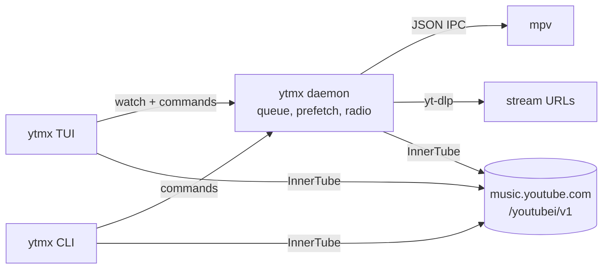

# ytmx

YouTube Music in the terminal: a fast TUI and a scriptable CLI that talk to YouTube Music's own InnerTube API with your browser session. It is one Rust binary; audio goes through mpv.

Instead of hard-coding a command per feature, ytmx parses the same renderer JSON the web app renders and replays the same *endpoint* objects the web app's buttons dispatch. Any menu action music.youtube.com shows on a song, album, artist, playlist or page is available in the TUI (`m`) and in the CLI (`ytmx do`).

## Install

You need:

- [`mpv`](https://mpv.io) on `PATH` (plays the audio)
- [`yt-dlp`](https://github.com/yt-dlp/yt-dlp) on `PATH` (resolves stream URLs): `uv tool install yt-dlp` or `pipx install yt-dlp`, or point `YTMX_YTDLP` at it
- Rust 1.85+ to build
- For sign-in: [omp](https://omp.sh) and its browser relay (recommended), or a browser whose cookie files ytmx can read

```bash
git clone https://github.com/MaheshBhushan/ytmx && cd ytmx
cargo install --path .        # puts `ytmx` in ~/.cargo/bin
```

## Sign in

ytmx uses the session of a browser where you are already signed in to YouTube Music. The recommended way is the **omp browser relay**, which lets ytmx read the cookies of your open music.youtube.com tab. It works with any Chrome profile and on systems where cookie files are encrypted or sandboxed.

One-time setup:

```bash
omp browser-relay install     # writes the extension to ~/.omp/browser-relay/extension
```

Then in Chrome: open `chrome://extensions`, turn on **Developer mode**, click **Load unpacked** and pick `~/.omp/browser-relay/extension`. The **OMP Browser Relay** badge shows "on" once a relay is running.

Each time you sign in:

```bash
omp browser-relay             # serve the relay (default port 9224); leave it running
# open https://music.youtube.com in Chrome, signed in to the account you want
ytmx login                    # reads that tab's cookies through the relay
ytmx whoami
```

You only need the relay while running `ytmx login`. Sign in again when YouTube expires the session.

Other ways in:

```bash
ytmx login --relay --relay-url ws://127.0.0.1:9333/cdp   # relay on another port (or $YTMX_RELAY)
ytmx login --browser chrome --profile "Profile 5"         # read cookie files directly (no relay)
ytmx login --browser firefox                              # chromium, brave, edge, vivaldi, opera, librewolf
ytmx login --list-profiles                                # Chrome profiles (* = last used)
ytmx login --cookie 'SAPISID=…; …'                        # paste a Cookie header from DevTools
ytmx logout
```

Without `--relay` or `--browser`, `ytmx login` uses the relay if one is listening and otherwise reads the last-used Chrome profile's cookie files. The session is stored in `~/.config/ytmx/session.json` (mode 0600); ytmx never sees your password. Signed out, search and playback still work.

## TUI

Run `ytmx` with no arguments.

| Key | Action |
|---|---|
| `1`–`5` | Home, Explore, Library, Liked, History |
| `/` `s` | Search with live suggestions (`↓` picks one) |
| `Enter` | Open or play the selection (songs in an album/playlist play that list from there) |
| `P` | Play an album/playlist/artist without opening it |
| `m`, right-click | Every YouTube Music action for the selection |
| `.` `M` | Page actions: play, shuffle, mix, save, subscribe, edit, delete, sort, tabs |
| `[` `]` | Previous / next tab or filter chip (search filters, library sections, moods) |
| `a` `A` | Add to queue / play next |
| `x` | Start a mix from the selection |
| `L` / `l` | Like the selection / like what's playing |
| `S` | Save to a playlist (or a new one) |
| `N` | New playlist |
| `y` | Copy the link (OSC 52) |
| `Backspace` `Esc` | Back |
| `R` | Refresh |
| `space` `n` `p` | Play/pause, next, previous |
| `←` `→` (`⇧`) | Seek 5 s (30 s); click the progress bar to seek |
| `+` `-` / `0` | Volume / mute. This is the system output volume (PipeWire/PulseAudio), so it matches the tray and media keys, and changes made there show up in ytmx immediately |
| `r` `z` `o` | Repeat off/all/one, shuffle upcoming, autoplay on/off |
| `v` | Side pane: queue / lyrics |
| `Tab` | Focus the side pane; in the queue `Enter` jumps, `d` removes, `J`/`K` move, `C` clears |
| `q` / `Q` | Quit (music keeps playing) / quit and stop the music |

Pages load more as you scroll. Below 100 columns the side pane folds behind `Tab`.

## CLI

Every listing is numbered, and those numbers are refs for the next command. A ref can also be a video, playlist, album or channel id, a music.youtube.com URL, `page` (the last page's own actions), `current`, or, for `play`/`add`, a search query.

```bash
ytmx search anuv jain                 # all results; -f songs|videos|albums|artists|playlists|featured|episodes|podcasts|profiles
ytmx search arz kiya --library -f songs
ytmx suggest anuv
ytmx open home|explore|library|liked|history|charts|moods|new|playlists|songs|albums|artists|subscriptions|profiles|podcasts|episodes|uploads
ytmx open 3                           # open result 3 (artist, album, playlist, category…)
ytmx open t2                          # tab/chip 2 of the last page
ytmx open history --all               # follow continuations

ytmx actions 3                        # every web-app action on result 3
ytmx do 3 "save to library"           # run one (toggles accept either side)
ytmx do 3 "save to playlist" --to Mix # pick a playlist; an unknown name creates it
ytmx do 3 "remove from history"
ytmx do page shuffle                  # page actions: shuffle, mix, subscribe, sort…
ytmx do page "delete" --yes

ytmx play "jo tum mere ho"            # query, ref, id or URL; a song plays as its radio
ytmx play 4                           # an album/playlist/artist plays the whole thing
ytmx add 5 6 --next                   # queue (or play next)
ytmx radio [ref]
ytmx like|dislike|unlike [ref]        # default: what's playing
ytmx save [ref] --to "My playlist"
ytmx lyrics [ref]
ytmx related [ref]
ytmx subscribe|unsubscribe <artist ref>

ytmx status | queue
ytmx pause | resume | toggle | next | prev | stop | clear | shuffle
ytmx seek 30 | seek -10 | seek --to 1:30
ytmx volume 60 | volume +5 | mute     # the system output volume; YTMX_MIXER=mpv uses mpv's own instead
ytmx repeat [off|all|one] | autoplay [on|off]
ytmx jump 7 | remove 7 | move 7 2

ytmx playlist create "Road trip" -p private 3 4 5
ytmx playlist edit <ref> --title … --description … --privacy unlisted
ytmx playlist add <ref> 3 4
ytmx playlist remove <ref> 2           # numbers from `ytmx open <playlist>`
ytmx playlist delete <ref> --yes

ytmx raw browse '{"browseId":"FEmusic_home"}'   # any InnerTube call, JSON out
ytmx quit                                       # stop the background player
```

Add `--json` to any command for machine-readable output.

## How it works



- A background daemon (started on first use, `$XDG_RUNTIME_DIR/ytmx-$USER.sock`) owns mpv and the queue, so the TUI and one-shot commands share one player and music survives closing the TUI.
- mpv holds at most [current, next]. The next track's stream is resolved while the current one plays and appended, so mpv pre-buffers it: transitions are gapless and `next` is instant.
- When the queue runs low it continues the radio (the `/next` continuation), and with autoplay on it starts a radio from the last track.
- Every play is reported to your history the way the web player does it.
- Client version and visitor id are refreshed from the homepage once a day (`~/.cache/ytmx/client.json`).

## The protocol (captured from a logged-in music.youtube.com)

Everything is `POST https://music.youtube.com/youtubei/v1/<endpoint>?prettyPrint=false` with a JSON body `{"context": {"client": {"clientName": "WEB_REMIX", "clientVersion": "1.2026…", "hl": "en", "gl": "DE", "visitorData": …}, "user": {}}, …}`.

Auth is the cookie jar plus

```
authorization: SAPISIDHASH <ts>_<sha1("<ts> <SAPISID> https://music.youtube.com")>
               SAPISID1PHASH <ts>_<sha1 with __Secure-1PAPISID>
               SAPISID3PHASH <ts>_<sha1 with __Secure-3PAPISID>
x-goog-authuser: 0
x-origin: https://music.youtube.com
x-youtube-client-name: 67
x-youtube-client-version: <clientVersion>
```

The web client gzips request bodies (`content-encoding: gzip`); the server also accepts plain JSON.

| Endpoint | Body | Used for |
|---|---|---|
| `browse` | `browseId`, `params` / `continuation` | every page: `FEmusic_home`, `FEmusic_explore`, `FEmusic_library_landing`, `FEmusic_liked_playlists`, `FEmusic_liked_videos`, `FEmusic_liked_albums`, `FEmusic_library_corpus_track_artists`, `FEmusic_library_corpus_artists`, `FEmusic_library_user_profile_channels_list`, `FEmusic_library_non_music_audio_list`, `FEmusic_library_privately_owned_tracks`, `FEmusic_history`, `FEmusic_charts`, `FEmusic_moods_and_genres`, `FEmusic_new_releases(_albums)`, `VL<playlist>`, `MPREb_…` album, `UC…` artist, `MPLY…` lyrics, `MPTR…` related, `MPTC…` credits |
| `search` | `query`, `params` (filter) | search; filters are chips in the response |
| `music/get_search_suggestions` | `input` | live suggestions |
| `next` | `videoId`, `playlistId`, `params`, `index` / `continuation` | the play queue, radio (`RDAMVM<id>`, `params: wAEB`), lyrics/related tabs |
| `music/get_queue` | `videoIds` / `playlistId` | items for "play next" / "add to queue" |
| `player` | `videoId`, `playbackContext` | `playbackTracking.videostatsPlaybackUrl`, GET with `&ver=2&c=WEB_REMIX&cpn=<16 chars>` to record history |
| `like/like` `like/dislike` `like/removelike` | `target: {videoId \| playlistId}` | ratings, saving albums/playlists |
| `feedback` | `feedbackTokens: [...]` | save/remove from library, remove from history, pin, not interested |
| `subscription/subscribe` `…/unsubscribe` | `channelIds`, `params` | artists and profiles |
| `playlist/create` | `title`, `description`, `privacyStatus`, `videoIds` | new playlists |
| `browse/edit_playlist` | `playlistId`, `actions: [ACTION_ADD_VIDEO \| ACTION_REMOVE_VIDEO \| ACTION_SET_PLAYLIST_NAME \| …_DESCRIPTION \| …_PRIVACY]` | playlist edits |
| `playlist/delete` | `playlistId` | delete |
| `playlist/get_add_to_playlist` | `videoIds` / `playlistId` | the "Save to playlist" picker |
| `account/account_menu` | | who is signed in |

Streams (`streamingData.adaptiveFormats`) are `signatureCipher`-protected and the web player sends a PO token, so ytmx hands stream resolution to yt-dlp and caches the direct URLs until they expire.

Notes from the capture: toggle menu items carry both sides plus `isToggled`; subscribe buttons come either as `on(Un)SubscribeEndpoints` or as `serviceEndpoints` with the unsubscribe wrapped in a confirm dialog; library chips are `commandExecutorCommand`s wrapping a `browseEndpoint`; sorting is a `browseSectionListReloadEndpoint` continuation; search results arrive either as shelves or as one `itemSectionRenderer` per row. Subscription and library changes take a few seconds to show up in pages.

## Limits

- Things the web app does through its own dialogs (report a song, edit a playlist thumbnail) aren't implemented.
- Lyrics come from the web client's lyrics tab, which has no timestamps; the lyrics pane scrolls with playback proportionally.
- Uploading music is not implemented.

## Files

| Path | Contents |
|---|---|
| `~/.config/ytmx/session.json` | cookies (0600) |
| `~/.config/ytmx/player.json` | volume, repeat, autoplay |
| `~/.cache/ytmx/` | client config, last listing (refs), yt-dlp cookie jar, daemon log |

## Disclaimer

ytmx is an unofficial client, not affiliated with or endorsed by Google or YouTube. It uses YouTube Music's private web API, which can change without notice, with your own account and session. Use it in line with YouTube's Terms of Service. Your cookies stay on your machine.

## License

[GPL-3.0-or-later](LICENSE)
